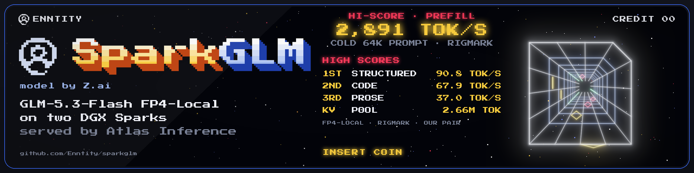

<p align="center">
  
</p>

# SparkGLM

GLM-5.3-Flash on two NVIDIA DGX Sparks, served by the
[Atlas](https://github.com/Enntity/atlas) inference engine: tensor and expert
parallelism across both boxes over one ConnectX-7 cable, NVIDIA's FP4-Local
checkpoint, DFlash2 speculative decoding, prefix caching, up to four
concurrent requests with a per-request limit of the model's full 1M context, and an
OpenAI-compatible API. Decoding is concurrency-invariant: a request's greedy
output does not depend on what else is running or on how the drafter proposes.
Prefill is not yet row-invariant, so a prompt long enough to prefill in
several chunks (over 8K tokens) can still differ when the engine is busy.
Multi-turn agents get a cached conversation back: a turn of a 45K-token
conversation starts in under a second instead of re-reading the whole
transcript.

```sh
git clone https://github.com/Enntity/sparkglm.git
cd sparkglm
cp .env.example .env      # set WORKER to the other Spark's ssh destination
./start.sh
```

## What it does

Measured on two DGX Sparks joined by one 200G cable. Rows marked † are this
release, FP4-Local: RigMark and ToolEvalBench on the release image
`c8ced64316bf`, the other † rows on dev binaries of the same engine. The
unmarked rows ran images built from a fresh clone with the NVFP4 checkpoint. Receipts and caveats:
[this release: FP4-Local, ToolEvalBench, kindling's benchmarks](results/2026-10-17-fp4local/RESULT.md),
[the shared engine](results/2026-10-15-shared-engine/RESULT.md),
[RC4: faster single-stream decode, bit-exact with RC2](results/2026-10-12-rc4/RESULT.md),
[RC2: KV shard, deterministic verify, faster MoE decode](results/2026-10-09-rc2/RESULT.md),
[the display carveout's KV placement](results/2026-10-05-carveout-placement/RESULT.md),
[a faster verify step and cheaper warm turns](results/2026-09-30-decode-step/RESULT.md),
[RigMark decode, prefill and staggered arrivals on 2026-10-05](results/2026-10-05-rigmark/RESULT.md),
[RigMark short-code concurrency](results/2026-09-30-rigmark/RESULT.md),
[prefix cache on disk](results/2026-09-30-nvme-tier/RESULT.md),
[exact kernels and the prefix-cache policy](results/2026-09-30-exact-speedups/RESULT.md),
[index tails and 0.92 memory](results/2026-09-29-index-tails-092/RESULT.md),
[prefix caching](results/2026-09-29-prefix-caching/RESULT.md)
and [the first Atlas release](results/2026-09-29-atlas-merged/RESULT.md)
(quality row).

| Workload | SparkGLM (Atlas) | Reference, same pair |
|---|---|---|
| Multi-turn conversation, 30–48K tokens: time to first token on turns 2+ (median) | **0.67 s** | 17.6 s with caching off |
| Four concurrent ~204K-token sessions, cached follow-up turns † | 12/12 numbers retrieved (two cut to 3 digits by the probe's token cap) | |
| KV pool shared by all requests (0.91, display carveout, disk prefix cache on) † | **2.66M tokens** (2.90M on the release image's start), up to 1M per request | 2.34M with the NVFP4 checkpoint, same engine |
| Same greedy output at 1 and 4 concurrent requests † | **8/8 prompts** | 0/4 on 2026-10-09 morning |
| Replaying a 35K-token prompt † | **0.38 s** (13.4 s cold) | |
| New session sharing a 24K system prompt with earlier ones: time to first token | **15.7 s** | 36.2 s with the cache policy off |
| Idle session resuming after another session's 17 turns (median) | **2.5 s** | 49.6 s with the cache policy off |
| Cold prefill, 32K / 128K random words (kindling's `prefill.py`) † | **2,645 / 2,733 tok/s** (2,886 / 3,002 with 16K chunks) | [kindling](https://github.com/kindlingai/glm-5.3-flash-gx10) vLLM TP=2 (published) 2,931 / 2,871 |
| Matrix: C1/C2 at 16K and 32K, C4 at 16K, 400 tokens each, cold (sum of walls) | **132.1 s** | vLLM SparkGLM 206.6 s · Mia TensorFold v1.10 166.9 s |
| Staggered C4: four ~16K requests arriving 1 s apart, cold (median of 5) | **49.5 s** | vLLM SparkGLM 70.5 s · Mia TensorFold v1.10 60.2 s · Mia EXL3 113.2 s |
| Staggered C4: four ~32K requests arriving 1 s apart, cold (median of 3) | **76.3 s** | Mia TensorFold v1.10 100.1 s |
| Single-stream decode, kindling's `bench.py`, code / prose / structured / counting (thinking off, 16 prompts each) † | **72.8 / 44.4 / 99.5 / 112.2 tok/s** | kindling vLLM TP=2 (published) 66.2 / 42.6 / 94.7 / 97.2 |
| Mixed streams, kindling's `bench.py`, 4 / 8 at once, aggregate † | **82.6 / 100.6 tok/s** | kindling TP=2 (published) 82.6 / 109.6; 89 / 116 remeasured |
| RigMark decode, code / prose / structured (thinking on, low effort) † | **67.9 / 37.0 / 90.8 tok/s** | [RiNGSiDE](https://github.com/othexmr/GLM-5.3-Flash-NVFP4-2x-4x-DGX-Sparks-RiNGSiDE) vLLM TP2 (published) 56.5 / 33.0 / 83.4 · NVFP4 checkpoint (RC4) 72.3 / 38.3 / 91.7 |
| RigMark cold prefill 8K / 32K / 64K: time to first token † | **3.21 / 11.89 / 22.67 s** | RiNGSiDE 3.56 / 12.94 / 25.66 s · RC4 3.29 / 12.47 / 23.91 s |
| RigMark staggered arrivals, prefill first: newcomer time to first token at 2 / 4 † | **2.64 / 3.36 s** | RiNGSiDE 4.70 / 5.15 s · RC4 2.80 / 3.54 s |
| RigMark short code, 1 / 4 / 6 streams, aggregate † | **47.8 / 72.2 / 81.4 tok/s** | RiNGSiDE 44.0 at 1 stream, 97.3 at 6 · RC4 47.0 / 70.9 at 1 / 4 |
| Returning to a ~209K-token conversation evicted to disk (prefix cache on disk, 48 GB) | **1.2–1.5 s** | about 82 s without it |
| Strict JSON (`response_format` json_schema), ~2,000-token structured answer | **30–50 s**, schema-valid | 135–155 s with masked serial decode |
| Strict JSON object with 96 required keys, temperature 0 | **39 s**, 59 tok/s, valid | engine killed (out of memory) two releases ago |
| ToolEvalBench, 69 scenarios × 3 trials, temperature 0 † | **91.0** (91 in one trial on the release image) | NVIDIA's model card: FP4-Local 92.4, BF16 91.9 (an earlier 63-scenario version) |
| Quality probe: arithmetic / two-hop 24K needle | 39/40 · 12/12 † (the same as with NVFP4); 491/500 · 24/24 on the 500-item set (NVFP4) | every engine configuration we ran scored 484–495/500 |

These are measurements on our pair, not a guarantee for yours. Rows not re-run
for this release keep the receipts linked above. Against RC4 on the NVFP4
checkpoint, FP4-Local prefills 2–5% faster and RigMark decode is 1–6% slower:
the QAD weights change how often the drafter's proposals are accepted, so
decode speed is not an engine-only comparison
([details](results/2026-10-17-fp4local/RESULT.md#speed)). Kindling's figures are for
their vLLM recipe with the NVFP4 checkpoint; ours ran their benchmark scripts
against FP4-Local ([details](results/2026-10-17-fp4local/RESULT.md#speed)). Our
profiles prefill in 8K chunks: 16K chunks are faster but halve the KV pool. Known gaps and open questions
are in [docs/LIMITATIONS.md](docs/LIMITATIONS.md).

## Requirements

- Two DGX Spark (GB10, 128 GB) systems joined by a direct ConnectX-7 cable,
  with an IPv4 address on the cable's interface on each (RoCE; the engine
  finds the GID itself and uses both PCIe halves of the port).
- Docker with the NVIDIA runtime on both, and passwordless `ssh` from the
  Spark you run `./start.sh` on to the other one, whose user can run `docker`.
- About 190 GB free on each Spark: the checkpoint takes 177.5 GB (165.3 GiB)
  and the drafter 2 GB. The download is made once and copied to the other
  Spark over the cable. Nothing is converted. (The earlier NVFP4 checkpoint,
  which `.env` can still select, takes 204 GB plus a 16 GB overlay.)
- Nothing else using the GPUs' memory. GB10 memory is shared with the host,
  and the engine uses most of it.

## What `./start.sh` does

Run it on the Spark that will serve the API (rank 0). Each step is skipped when
already done, so rerunning it just restarts the engine.

`start.sh` manages a TP2 pair. Four-Spark TP4 uses [LLooM](https://github.com/Enntity/lloom)
with the `linux-nvidia-dgx-spark-4x-glm53-atlas-tp4` recipe, which configures
the chain and starts all four ranks. The `4x1m-tp4` profile requires that
four-rank orchestration.

1. **Image.** Pulls `ghcr.io/enntity/atlas-sparkglm:<tag>`, whose tag is the
   git tree of [`install/`](install/), so the image always matches your
   checkout. If it isn't published or `BUILD=1` is set, it builds the image
   from source instead ([`install/build.sh`](install/build.sh): Atlas at the
   commit pinned in [`install/atlas-source.json`](install/atlas-source.json),
   FlashKDA and FlashInfer's sparse-MLA prefill; 30–60 minutes cold). It then
   pulls or copies the image to the other Spark.
2. **Weights.** Downloads [`nvidia/GLM-5.3-Flash-FP4-Local`](https://huggingface.co/nvidia/GLM-5.3-Flash-FP4-Local)
   and the [`incoai/GLM-5.3-Flash-DFlash2`](https://huggingface.co/incoai/GLM-5.3-Flash-DFlash2)
   drafter at pinned revisions, and copies them to the other Spark. It uses
   `hf` when installed and a throwaway container otherwise.
3. **Overlay, NVFP4 checkpoint only.** FP4-Local is served as published. If
   `.env` selects the NVFP4 checkpoint ([below](#the-checkpoint)), this step
   converts the 864 BF16 MTP matrices Atlas needs to NVFP4 in an overlay on
   each Spark and verifies every payload (about a minute;
   [`install/convert.sh`](install/convert.sh)).
4. **Serve.** Starts rank 1 over ssh, then rank 0, and waits for health
   (about 2.5 minutes), then answers one smoke-test question.

Other commands: `./start.sh stop | status | logs [worker] | build | download | convert`.

## Use it

The API listens on rank 0's loopback, `http://127.0.0.1:8893/v1`, model
`glm-5.3-flash-atlas`, with no authentication. Put your own authenticated
proxy in front of it before exposing it.

```sh
curl -s http://127.0.0.1:8893/v1/chat/completions -H 'Content-Type: application/json' -d '{
  "model": "glm-5.3-flash-atlas", "max_tokens": 256,
  "messages": [{"role": "user", "content": "Write a haiku about two small computers."}]}'
```

Streaming, tool calls, JSON and structured output, reasoning controls
(`chat_template_kwargs.enable_thinking`, `reasoning_effort`), images and short
videos are supported.

When an agent repeats the same tool call and gets the same result, the engine
adds a repeat notice to that result and lets the model think harder on that
turn; it no longer blocks tool calls, which had left the model narrating the
action it meant to take ([RC4.2](results/2026-10-12-rc4/RESULT.md)).

**Profiles** (`PROFILE` in `.env`):

- `4x1m` (default): up to four requests with up to 1,048,576 tokens each, the
  model's full window.
- `4x512k`: up to four requests with up to 512K each.
- `8x128k`: up to eight requests with up to 128K each, for more concurrent
  short work.

The context limit applies to each request; it does not reserve that much KV
for every concurrent slot. At the measured 2.66M-token pool size, four full
1M-token requests cannot fit together. Requests wait when the pool lacks room.

All requests share one FP8-latent KV pool that also holds the prefix cache.
The KV cache is split between the two Sparks (`KV_SHARD`, on by default): each
stores the latents of half the blocks, so the pool holds about 1.8x the tokens,
and the output is bit-identical to the unsplit pool's. On Sparks that run
nothing else, at `GPU_MEMORY_UTILIZATION=0.91` with the display carveout and
the disk prefix cache (both below), the pool is about 2.66M tokens with
FP4-Local (2.5–2.7M across starts). Four concurrent 204K-token sessions left
rank 0 at 3.3 GB free at worst. Above
0.91, real traffic took our rank 0 below 1 GiB free
([docs/LIMITATIONS.md](docs/LIMITATIONS.md)). Requests that don't fit wait for
room. Prefix caching keeps the 16 most recent conversations' recurrent state
warm.

## The checkpoint

[`nvidia/GLM-5.3-Flash-FP4-Local`](https://huggingface.co/nvidia/GLM-5.3-Flash-FP4-Local)
@ `76348ddb` is NVIDIA's quantization-aware distilled release: routed experts
in NVFP4 with losslessly compressed block scales, the KDA projections, dense
MLP and `lm_head` in MXFP8, the MLA projections and shared experts in FP8 with
128x128 block scales, and the MTP layer and vision tower already quantized. It
is 25 GiB smaller than NVIDIA's earlier NVFP4 release, so the KV pool gains
about 13%, and it needs no overlay.

The engine serves every group in the checkpoint's own format
(`ATLAS_GLM_FP4L_NATIVE=1`): requantizing FP4-Local's QAD-trained MXFP8 and
FP8 weights to NVFP4, as the 2026-10-17 release did, lost long-context
retrieval ([docs/LIMITATIONS.md](docs/LIMITATIONS.md)). ToolEvalBench scores 91.0 on our
pair; NVIDIA's card gives 92.4 for FP4-Local and 91.9 for BF16 on an earlier
version of the suite ([receipts](results/2026-10-17-fp4local/RESULT.md#toolevalbench)).

The NVFP4 checkpoint still runs on the same image, with production's prompt
logprobs bit for bit. To use it, add both lines to `.env` and rerun
`./start.sh`; it downloads the checkpoint and converts its overlay:

```sh
CHECKPOINT_REPO=nvidia/GLM-5.3-Flash-NVFP4
CHECKPOINT_REVISION=423acf37583782c51c142d145aef733d72943d93
```

## Prefix cache on disk (optional)

When the KV pool fills up, the prefix cache drops the conversations used
least recently, and one that comes back is prefilled again from the start.
With `PREFIX_CACHE_DIR` set, each Spark writes what it drops to its own disk
instead and reads it back when the conversation returns. In one pass on
2026-09-30, with 25K-token conversations pushed out of the cache, the time to
first token of turn 2 went from 10.7 s to 0.91 s and the answers were
byte-identical. Each restore read its blocks in about 75 ms (7.8 GB/s). With
the KV shard (the default) each Spark spills and restores only the latents it
owns: on 2026-10-09 a 25K-token conversation came back in about 40 ms per
restore (5.2 GB/s), and turns 2-4 after three restores were byte-identical to a
run that never evicted, token logprobs included.

To turn it on, add to `.env` and rerun `./start.sh`:

```sh
PREFIX_CACHE_DIR=/srv/sparkglm/prefix-cache   # same path on both Sparks, on their own disk
PREFIX_CACHE_GB=48                             # GiB per Spark, 16-100 (default 48)
```

`start.sh` creates `kv/` and `ssm/` in the directory on both Sparks, refuses a
directory on tmpfs or without that much space free, and mounts it into each
rank. Half of the size holds KV blocks (6.66 KB per token unsplit, 3.7 KB per
Spark with the KV shard; 24 GiB holds 3.9M or 6.9M tokens). The other half holds the 78 MB
recurrent-state snapshots a restore starts from (24 GiB holds 330). A restore
needs both, so at 25K tokens the even split keeps about 150 conversations with
two snapshots each.

What it costs, per Spark:

- **KV pool.** The engine sets host memory aside for the tier and takes it
  out of the pool: 236 MiB whatever the size (staging, and two snapshot
  slots), plus 640 B for each 16-token block the KV half can hold, which is
  6.2 MiB per GiB. At the default that is 383.8 MiB. On our pair at 0.93 the
  pool lost about 4,000 of its 104,000 blocks, about 60K tokens (4%); at the
  default 0.88 the same 60K tokens are about 10% of the pool. With the KV
shard each block costs each Spark about half as much memory, so the same
reservation takes about twice the tokens: at 0.91 with the carveout the pool
goes from 163,177 to 147,480 blocks (2.61M to 2.36M tokens). Each GiB added
  to `PREFIX_CACHE_GB` costs about 500 more tokens. The fixed part is most of
  the cost, and 48 is the size we measured.
- **Disk.** The KV half is reserved when the engine starts; the snapshot half
  fills as needed. Every token pushed out of the pool writes 6.66 KB. Nothing
  is kept across a restart: the engine deletes its files as soon as it has
  them open, and clears leftovers from a crash when it starts.

## Display memory as KV cache (optional, DGX Spark only)

Each DGX Spark's firmware sets aside 2 GiB of memory for the display (the
`DISPLAY_FRM` carveout). Linux never sees it; the NVIDIA driver manages it as
the display's own memory pool, and on a headless Spark the display uses only
a few MiB of it. With `DISPLAY_CARVEOUT=1`, the engine asks the driver for
the rest (about 2042 MiB) and borrows it for the KV cache: it places whole
per-layer latent KV pools there, so the pool grows while system memory stays
exactly as it was. Because the driver hands it out, it never overlaps what
the display uses, and the GPU caches it like ordinary memory
([results/2026-10-14-vision-prefix-cache](results/2026-10-14-vision-prefix-cache/RESULT.md)).

On our pair at 0.91 GPU memory utilization, the pool grows from 70,501 to
86,005 blocks per Spark (+19.4%, about 1.13M to 1.38M tokens). Cold prefill
at 32K and 64K stays within 0.7% of the carveout off, and greedy outputs are
unchanged.

To turn it on, add to `.env` and rerun `./start.sh`:

```sh
DISPLAY_CARVEOUT=1   # default off; set 0 or delete the line to roll back
```

What it takes:

- **No extra container privilege.** The engine starts through
  `spark display-carveout`, which allocates the memory from the driver, takes
  a host lock and then starts the server.
- **One user per Spark.** The lock in `/run/lock/sparkglm` lets one process
  per host hold the carveout. `start.sh` creates the directory.
- **Driver.** Every NVIDIA open GPU kernel module release from 580.76.05 to
  615.78.08 provides it; the engine checks what the driver gives rather than
  its version. If the driver cannot lend it, the engine serves without the
  carveout and logs why.
- **A headless Spark.** The engine takes what the display is not using when
  it starts; a display attached later may find no room for its surfaces.
  We run ours headless.

This is SparkGLM-only: it ships in the SparkGLM layer of the engine fork, not
in the upstream Atlas series. The idea comes from kindling-spark-os's
`dispram` (see [Credits](#credits)).

## Reproduce our numbers

The benchmark drivers are in [`bench/`](bench/). See
[docs/REPRODUCE.md](docs/REPRODUCE.md) for the exact commands and the
comparison videos.

## Other ways to run it

- **By hand:** every step of `./start.sh` as a separate command, in
  [docs/INSTALL-MANUAL.md](docs/INSTALL-MANUAL.md).
- **With [LLooM](https://github.com/Enntity/lloom):** the recipe
  `linux-nvidia-dgx-spark-2x-glm53-atlas` puts SparkGLM behind LLooM's
  authenticated gateway ([docs/LLOOM.md](docs/LLOOM.md)).

## The engine

Atlas here is [`Enntity/atlas`](https://github.com/Enntity/atlas) release tag
`sparkglm/atlas-20261017-fp4local` at `b3b016ab` (tree `14316380`, pinned in
[`install/atlas-source.json`](install/atlas-source.json)); what it adds and its
opt-in switches are in [docs/ENGINE.md](docs/ENGINE.md). The fork keeps one
branch per layer: `spark-shared`, which SparkQwen builds on too, and `sparkglm`
on top of it ([branch and release index](https://github.com/Enntity/atlas/blob/enntity/releases/docs/PUBLISHED_RELEASES.md)).
The engine is built from three layers:

1. Atlas-Inf `main` at `7ffd183f`.
2. The shared Spark engine layer `upstream/atlas-shared-20261015-vision` at
   `a9464810`, which [SparkQwen](https://github.com/Enntity/sparkqwen) builds on too. It holds
   GLM-5.3-Flash support and optimizations, which we intend to propose to
   Atlas-Inf after review (it started as Reiner Schmidt's port,
   [Mango-kid/atlas](https://github.com/Mango-kid/atlas/tree/feat/glm53-dual-spark);
   the engine's `docs/porting/GLM_5_3_FLASH.md` has the history); the
   Qwen3.8-Flash-Next series, whose paths stay off for GLM; and the
   model-independent work both products share: speculation that commits
   exactly the tokens plain greedy decode commits (one lowest-index tie rule),
   shared-prefix admission, opt-in content-loop steering, batched prefix-cache
   eviction, the refusal-content fix (Atlas-Inf issue 172), the vision
   prefix cache below and the vision fixes both models share: every vision
   tower encodes per chunk into per-sequence state, a malformed vision
   layout fails only its request, MRoPE positions come from the whole
   prompt, and vision markup typed in message text encodes as text.
3. SparkGLM-only commits: FlashKDA and native sparse-MLA prefill bridges,
   which rely on libraries built outside the Atlas tree, the GB10 display
   carveout (including where the split KV pools are placed in it), and the
   FP4-Local series: the compressed-scale decoder and loader, four exact
   prefill options the profiles turn on, the tools + `response_format` union
   grammar and the opt-in checkpoint-format path. Its model-independent
   commits (`shared:`) are candidates for the shared layer.

The profiles set `ATLAS_MOE_INPLACE_TRANSPOSE=0`: the shared engine's default
in-place MoE transpose keeps every expert's allocation, which on GB10 costs
about 1.5 GB of kernel memory per Spark that the KV pool would otherwise get.
Against the previous engine, text prompts score the same prompt logprobs and
the prefix-cache, fill, tool-call and vision checks pass
([results/2026-10-15-shared-engine](results/2026-10-15-shared-engine/RESULT.md)).

**Image prompts use the prefix cache.** Every image used to be the same run
of placeholder tokens, so image prompts bypassed the prefix cache entirely:
once an image entered a long conversation, every turn re-prefilled the whole
history and re-encoded every image. The cache key now replaces each
placeholder with an id derived from its image's SHA-256 content hash, so a
different image never shares KV and the same image hits; text before the first
image keys as before. Only images a prefill actually computes go through the
vision encoder, the second Spark no longer loads the vision tower (rank 0
encodes and sends the rows), and concurrent image prompts keep their vision
state per request. Text prompts run exactly as before (prompt-logprob hash
unchanged). Receipts: [results/2026-10-14-vision-prefix-cache](results/2026-10-14-vision-prefix-cache/RESULT.md).

These are published Enntity release snapshots, separate from current
Atlas-Inf `main`; the manifest's `layers` entries record the layering.

## History

SparkGLM started as an Atlas research project: GLM-5.3-Flash on two DGX
Sparks with the Atlas engine. vLLM was far ahead at the time, so we moved to
it. On vLLM we started from an early version of
[MiaAI-Lab](https://github.com/MiaAI-Lab/GLM-5.3-Flash-EXL3-2x-DGX-Sparks)'s
two-Spark EXL3 recipe and reworked it, mostly for concurrency. We then
decided there was a lot we needed to fix at the engine level, and went back
to Atlas. Atlas is now the only engine.

The vLLM version is retired. It is preserved at the tag
[`vllm-final`](https://github.com/Enntity/sparkglm/tree/vllm-final) and the
branch `archive/vllm`, including its results and qualification records.

## Credits

The engine options SparkGLM turns on take their ideas from other projects. The
code is ours unless [docs/LICENSING.md](docs/LICENSING.md) says otherwise.

| Option | Idea from |
|---|---|
| `ATLAS_DFLASH_CONF_WIDTH` | knapcio's draft-shape truncation, `GLM_DRAFT_TRUNC` ([knapcio/GLM-5.3-Flash-4x-DGX-Spark-TP4](https://github.com/knapcio/GLM-5.3-Flash-4x-DGX-Spark-TP4)), whose calibration table (MIT) seeds ours; and the survival prefix product of D-Cut ([arXiv 2607.14647](https://arxiv.org/abs/2607.14647)) as Atlas-Inf implements it for MTP. We added online calibration, a fixed row price and a periodic full-width probe. |
| `ATLAS_GLM_DRAFT_TP` | MiaAI-Lab's `DFLASH_DRAFT_TP` ([GLM-5.3-Flash-EXL3-2x-DGX-Sparks](https://github.com/MiaAI-Lab/GLM-5.3-Flash-EXL3-2x-DGX-Sparks)) and TensorFold's two-rank drafter ([ashhart/TensorFold](https://github.com/ashhart/TensorFold)) |
| `ATLAS_GLM_PC_EVICT` | Reederey87's prefix-cache eviction policy ([glm53-flash-exl3-2x-dgx-spark](https://github.com/Reederey87/glm53-flash-exl3-2x-dgx-spark)) |
| `ATLAS_GLM_PC_BRANCH` | Marconi's branch-point admission (Pan et al., MLSys 2025, [arXiv:2411.19379](https://arxiv.org/abs/2411.19379)) |
| `ATLAS_GLM_STRICT_SPEC` | vLLM's speculative decoding with structured outputs ([#14702](https://github.com/vllm-project/vllm/pull/14702)) and its reasoning-boundary fix ([#44297](https://github.com/vllm-project/vllm/pull/44297)): per-position grammar masks over the draft window, the bonus row included, with the matcher rolled back after rejected drafts. We added per-rank masking for the vocab-split verify head. |
| `ATLAS_GLM_CANONICAL_VERIFY` | Batch-invariant kernels, from Thinking Machines Lab's "Defeating Nondeterminism in LLM Inference" (Horace He, 2025): a row's result must not depend on the rows computed beside it. We apply it to every op a DFlash verify row touches, at every verify width. |
| `ATLAS_KDA_FLASH_PREFILL` (FlashKDA's FP32 recurrence) | vLLM's FlashKDA fork keeping the recurrent state in FP32 fragments between tiles, narrowed to BF16 only for the MMA operand ([vllm-project/FlashKDA#13](https://github.com/vllm-project/FlashKDA/pull/13), Matt Mastracci). We also keep the state FP32 across calls, split every MMA operand into BF16 hi/lo pairs and compute the gate, beta, inverse and sums in FP32, so the result matches the FP32 token recurrence. |
| `DISPLAY_CARVEOUT` | kindling-spark-os's `dispram` ([kindlingai/kindling-spark-os](https://github.com/kindlingai/kindling-spark-os), by mmastrac, coffee-the-dev and adapt-ai-systems; they credit an earlier NVIDIA developer forum post by emihuang). Our implementation was re-derived from the open GPU kernel modules and needs no daemon. |

Measurement: [RigMark](https://github.com/alexellis/rigmark) by Alex Ellis
(run from othexmr's fork with the staggered-arrival suite), the published
[RiNGSiDE](https://github.com/othexmr/GLM-5.3-Flash-NVFP4-2x-4x-DGX-Sparks-RiNGSiDE)
figures, [kindlingai/glm-5.3-flash-gx10](https://github.com/kindlingai/glm-5.3-flash-gx10)'s
`bench.py` and `prefill.py` and its published figures,
[tool-eval-bench](https://github.com/SeraphimSerapis/tool-eval-bench) by
SeraphimSerapis, [mmastrac](https://github.com/mmastrac/glm-5.3-flash-4x-gx10)'s
published figures and benchmark method (for earlier receipts), and MiaAI-Lab's
decode prompts.

## License

AGPL-3.0-only ([LICENSE](LICENSE)); third-party components keep their own
licenses ([NOTICE](NOTICE), [docs/LICENSING.md](docs/LICENSING.md)). The model
weights are not distributed here. FP4-Local is under the NVIDIA Open Model
Agreement. **The DFlash2 drafter is licensed CC BY-NC-ND 4.0
(non-commercial).** Check both checkpoints' terms before downloading.
