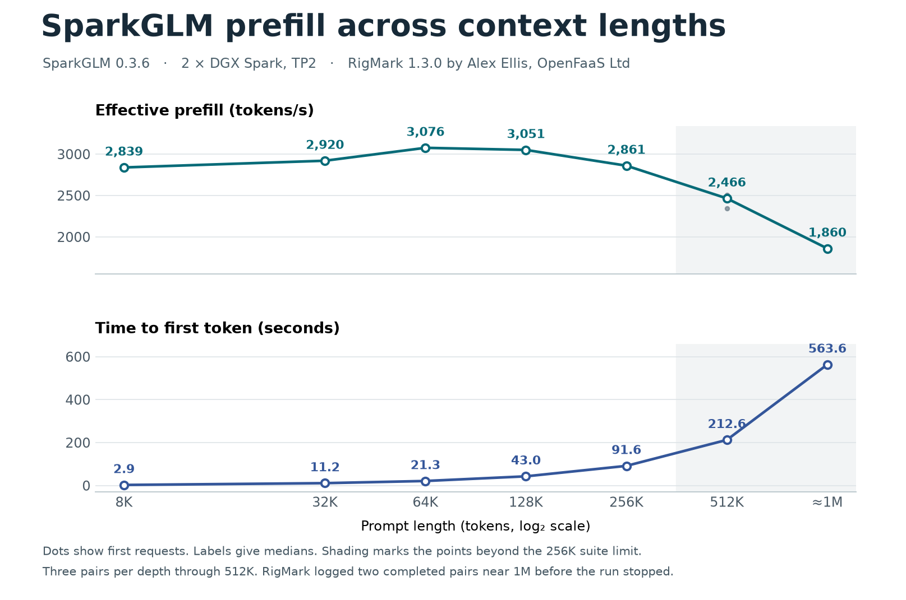

<!-- SPDX-License-Identifier: AGPL-3.0-only -->
# SparkGLM v0.3.6 · SparkModelBench

Measured November 26, 2026 on the released v0.3.6 image in Spark mode, with GLM-5.3-Flash FP4-Local and two DGX Sparks (TP=2). RigMark protocol 1.3.0, RigMark Quality v0.0.2, low reasoning effort. [Measured SparkModelBench revision](https://github.com/enntity/sparkmodelbench/tree/1b6187289c02e7b360bf8ea6ef752fe76a3b71b3).

Serving measurements and quality tasks by **Alex Ellis, OpenFaaS Ltd**. [RigMark](https://github.com/alexellis/rigmark) · [RigMark Quality](https://github.com/alexellis/rigmark-quality). Enntity adds the staggered four-request field guide.

## RigMark Quality · task completion

| Task | Checks passed | Finished | Seconds | Output tokens |
|---|---|---|---:|---:|
| python-expiry | True | True | 16.20 | 526 |
| go-transfer-ledger | True | True | 95.00 | 2726 |
| payment-recovery | True | True | 8.20 | 263 |
| evidence-revisions | True | True | 3.60 | 102 |

## RigMark · generation, median

| Workload | Tok/s | Last output (s) | Output tokens | Gates |
|---|---:|---:|---:|---:|
| code | 65.14 | 30.22 | 1924 | 5/5 |
| prose | 37.67 | 27.25 | 1019 | 5/5 |
| structured | 89.32 | 5.54 | 441 | 5/5 |

## SparkGLM · staggered C4

| Round | Wall (s) | Stream TTFT (s) | Longest visible gap (s) | Full streams |
|---|---:|---|---:|---|
| warmup | 46.03 | 6.02, 17.28, 22.35, 9.05 | 3.20 | True |
| 1 | 45.06 | 5.80, 16.83, 21.89, 8.74 | 3.20 | True |
| 2 | 45.95 | 5.79, 16.81, 22.17, 8.73 | 3.21 | True |
| 3 | 45.56 | 5.91, 16.84, 21.91, 8.84 | 3.22 | True |

Median measured wall time **45.56 s**.

## RigMark · prefill

| Prompt tokens | First TTFT (s) | First tok/s | Replay TTFT (s) | Replay tok/s | First cache evidence |
|---:|---:|---:|---:|---:|---|
| 8192 | 2.88 | 2,839.32 | 0.18 | 44,738.38 | zero cached tokens reported |
| 32768 | 11.22 | 2,920.44 | 0.20 | 164,009.75 | zero cached tokens reported |
| 65536 | 21.30 | 3,076.45 | 0.20 | 333,689.75 | zero cached tokens reported |
| 131072 | 42.96 | 3,051.09 | 0.22 | 602,510.77 | zero cached tokens reported |
| 262144 | 91.63 | 2,860.78 | 0.24 | 1,090,100.09 | zero cached tokens reported |
| 524288 | 212.64 | 2,465.64 | 0.31 | 1,694,049.53 | zero cached tokens reported |

The sweep also completed two first-request/immediate-replay pairs at 1,048,568 prompt tokens before the third was stopped. The two first requests reached 1,856.9 and 1,864.0 tokens/s, with first tokens at 564.697 and 562.542 seconds. The log retained both timings. Per-request cache counts are available through 512K. The regular suite ends at 256K.

